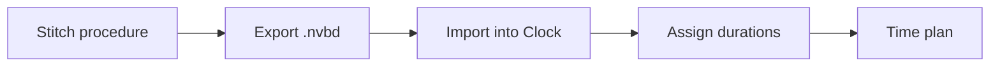

# Navboard

**Your world, in orbit.**

*Create up close. Organize from afar. Present anywhere.*

Navboard is a local-first Windows desktop composition environment built with Rust and Dioxus. Nine specialized instruments let you capture, structure and connect information without forcing every kind of work into the same editor.

**Current release:** v0.1.0 — Seafoam

## Getting started

1. Install Navboard using Navboard_0.1.0_x64-setup.exe from the repository's Releases section.
2. Launch Navboard to enter Orbit.
3. Choose an instrument to begin composing, or select the central orb to enter Worlds.
4. Assign a finished piece to a World to keep it alongside related work, or export a Navboard Manifest where supported.

## Orbit and Worlds

Orbit is the central navigation surface. Each of the nine instruments has its own entrance and color. Instruments can be used independently, without creating a project first.

Worlds are persistent collections of related pieces. A World might represent a client, a creative project, a technical environment or a personal collection. Assign pieces to an existing World or create a new one. Reopen assigned pieces to continue working with their native content.

## The nine instruments

| Instrument | Purpose |
| --- | --- |
| Text | Capture thoughts and knowledge |
| Canvas | Draw and illustrate |
| Stitch | Compose ordered procedures |
| Forge | Connect ideas and relationships |
| Clock | Plan time and durations |
| Specs | Collect structured properties |
| Echo | Transcribe spoken information |
| Lens | Organize visual evidence |
| Atlas | Map equipment and connections |

### 1. Text — capture knowledge

Use Text for notes, observations, explanations and written ideas. Start an independent Text session from Orbit, compose your material and assign it to a World when it belongs to a larger project.

**Example:** Keep troubleshooting observations beside an equipment map and a repair procedure in the same World.

### 2. Canvas — illustrate ideas

Canvas is a freehand drawing workspace with pen and eraser tools, adjustable brush size, color selection, dark, white and grid paper, and undo/redo controls. Use Clear to start over after confirmation.

**Example:** Sketch a proposed desk layout, annotate a concept or draw a quick diagram before formalizing it elsewhere.

### 3. Stitch — compose procedures

Build a procedure one step at a time. Add, edit, reorder, duplicate or remove steps, and review the resulting ordered procedure or checklist. Export the piece as a Manifest to use its steps in Clock.

**Example:** Write a workstation deployment procedure without having to estimate the time for each step yet.

### 4. Forge — connect concepts

Forge is a visual relationship composer. Place modules on the workspace, edit their titles and contents, move them around and connect their ports with cables. Module types include Idea, Resource, Task, Decision, Command, Variable, Condition and Output. Review the relationships in the composition.

Forge documents logic and relationships; it does not execute commands or automate the workflow.

**Example:** Map the dependencies and decisions involved in a software release.

### 5. Clock — compose time

Create time slots manually or import a Stitch Manifest to turn an ordered procedure into a time plan. Enter hours and minutes for each slot, reorder slots as needed and review cumulative durations, proportional bars and the total planned time.

Imported steps are a snapshot, not a live link to Stitch. Durations begin at zero so you can estimate them independently.

**Example:** Import a deployment checklist and estimate how long each stage will take.

### 6. Specs — structure information

Choose from starter templates for infrastructure, IMACD (Install, Move, Add, Change, Dispose) or general projects. Fill in known values, edit property names and add custom properties when needed. Leave unknown information blank rather than inventing it. Changing templates can replace the current fields and requires confirmation.

**Example:** Document a server's hostname, model, serial number, operating system, memory and verification date.

### 7. Echo — transcribe speech

Echo is a local transcription instrument designed around microphone input and computer audio output. Arm the desired channels, start capture, pause or resume as needed, and stop when finished. Review the chronological transcript or individual channels and copy the text for further use.

Echo uses a Python speech-recognition worker with local Faster Whisper inference. It is designed to retain text rather than audio recordings. Its experimental Privacy Shield attempts to redact suspicious speech before displaying it, but it can miss sensitive information or redact ordinary speech. Always review transcripts before sharing them. Obtain appropriate consent and authorization before transcribing other people.

**Example:** Transcribe your own spoken project notes while listening to a prerecorded tutorial.

**Release limitation:** Echo's Python environment, audio dependencies and model provisioning have not been verified on a clean Windows installation. Echo requires the optional runtime setup described below. Dual-channel transcription was successfully tested after installation on the development machine.

### 8. Lens — organize imagery

Import images into a visual reel, browse the frames, edit their titles and observations, and rearrange or remove them. Use the projector view to review the reel as a slideshow. The gallery export is designed to package original images and gallery notes into a ZIP archive.

**Example:** Assemble a collection of equipment photographs and screenshots with observations for each frame.

### 9. Atlas — map environments

Place equipment on a map and connect devices to represent a physical or logical topology. The starter palette includes Internet, firewall, router, switch, access point, server, workstation, laptop, printer, NAS, UPS and custom equipment. Select equipment to document its details, and create reusable custom equipment types.

Atlas is a documentation tool, not a network scanner or packet simulator.

**Example:** Map an Internet connection through a firewall and switch to access points, servers and workstations.

## Navboard Manifests

Navboard uses the `.nvbd` extension for its native Manifest format. Version 1 is structured JSON containing a piece's identity and native content. Manifest export is separate from assigning a piece to a World.

The Stitch-to-Clock workflow demonstrates cross-instrument composition:



General Manifest reopening and Windows file associations are not part of this initial release.

## Seafoam system tray launcher

Right-click the Navboard tray icon to open the independent Seafoam launcher. It provides shortcuts to the main window, Orbit, Worlds and all nine instruments, plus an Exit command.

When an editing session is active, navigation and exit commands are protected against replacing that session. Return to Orbit and reopen the launcher to access those commands again.

## Local storage and saving

Worlds are stored locally under `%LOCALAPPDATA%\Navboard`. Assigned World data currently uses automatic persistence with recovery snapshots. Independent, unassigned sessions are temporary; assign or export important work before leaving a session. A traditional manual-save workflow is planned but is not implemented in this release.

## Installation and release status

- Windows x64 desktop application using Microsoft Edge WebView2.
- Install using the Windows x64 setup executable attached to the GitHub release.
- The release candidate passed 34 automated tests, all nine tray instrument launch checks, tray Exit testing and an installed-application smoke test on the development machine.
- Clean-machine installation and Echo dependency provisioning have not been independently verified.
- The installer is unsigned. Windows SmartScreen may display a warning. Verify the supplied SHA256 checksum before installation.
- The protected-session tray warning can cause minor clipping of the disabled Exit button.

## Development

Built with Rust, Dioxus, CSS and a Python worker for Echo.

From the repository root, with the appropriate Rust and Dioxus development tools installed:

```powershell
cargo test --offline
dx serve --desktop
```

The offline test command assumes dependencies are already cached. A fresh development environment may need to fetch dependencies first.

## Philosophy

**Structure the information, not the human.**

Orbit is universal. Worlds are contextual. Instruments are reusable. Pieces are transferable.

Developed by **ColorsOfFractals**.


## License

Copyright (C) 2026 ColorsOfFractals.

Navboard is free and open-source software licensed under
the GNU General Public License, version 3.0 (GPL-3.0-only).

You are free to use, study, modify, and redistribute Navboard
under the terms of the GPL.

See [LICENSE](LICENSE) for the complete license text.

Third-party components retain their respective licenses.
Navboard is provided without warranty.


## Optional Echo Runtime Setup

Navboard includes all nine instruments. Echo requires an optional
Python 3.13 x64 environment for local speech recognition.

1. Install Python 3.13 x64 from https://www.python.org/downloads/windows/
   with the Python launcher enabled.
2. Open the installed Navboard echo-lab directory.
3. Review and run Setup-Echo.ps1 using PowerShell.
4. Restart Navboard.

Echo dependencies are obtained directly from PyPI using the supplied
version and SHA256 lock. Python, Python wheels, FFmpeg codec binaries,
and speech recognition model weights are not bundled in this installer.

The recognition model downloads separately on first use.
Other instruments do not require the Echo runtime.

Echo runtime storage:
%LOCALAPPDATA%\Navboard\Echo

Third-party dependencies retain their respective licenses.